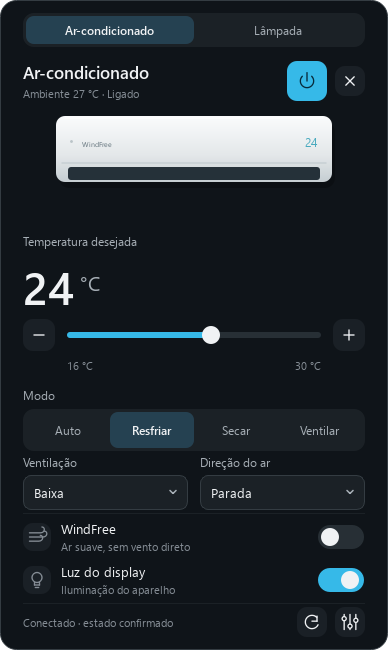
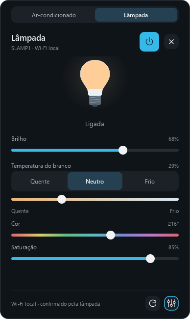
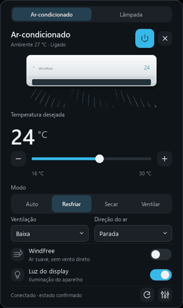
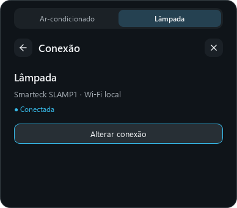

<p align="center">
  
</p>

<h1 align="center">Orbit</h1>

<p align="center">Ar-condicionado e iluminação, a um clique da bandeja do Windows.</p>
<p align="center"><strong>Controle local · Estado confirmado · Interface nativa</strong></p>

O Orbit reúne o controle do ar-condicionado Samsung e da lâmpada Tuya em um painel compacto. Clique no ícone junto ao relógio: os controles aparecem à direita, imediatamente acima da barra de tarefas. Ao clicar fora, o painel fecha e o app continua na bandeja.

## Um painel para cada dispositivo

<table>
  <tr>
    <th>Ar-condicionado</th>
    <th>Iluminação</th>
  </tr>
  <tr>
    <td></td>
    <td></td>
  </tr>
</table>

**Climatização:** energia, temperatura, modo, ventilação, direção, WindFree, conforto e luz do display, conforme os recursos do aparelho.

**Iluminação:** energia, brilho, três presets de branco, tonalidade e saturação. Os presets Quente, Neutro e Frio usam os canais de luz branca; a troca de RGB para branco preserva o brilho ativo.

Os comandos são confirmados pelo dispositivo. Um ajuste pendente fica identificado na interface, e uma falha mantém a última leitura real.

## Movimento que acompanha o estado

<p align="center">
  
</p>

Abertura, números, seletores e luz acompanham as mudanças de estado. O fluxo de ar anima enquanto o aparelho está ligado e o painel está aberto. A opção **Reduzir movimento** e a preferência de animações do Windows são respeitadas.

[Assistir à prévia em vídeo](assets/panel-motion-preview.mp4)

> Os previews usam dados de exemplo e os widgets reais do app. Não exibem credenciais ou identificadores pessoais.

## Configuração enxuta

<p align="center">
  
</p>

Uma lâmpada já configurada mostra apenas nome, conexão e **Alterar conexão**. Quando está offline, **Reconectar** reutiliza a chave salva. Os campos de pareamento aparecem somente ao configurar ou alterar a conexão; importação, ajuda e SmartThings ficam em **Mais opções**.

O Orbit recupera a conexão automaticamente e procura o mesmo dispositivo quando seu endereço muda. A inicialização com o Windows é opcional, com partida 15 segundos após o login.

## Controle direto pela rede

| Dispositivo validado | Transporte | Configuração |
| --- | --- | --- |
| Samsung AR12DYFAAWKNAZ | CoAP/DTLS local | Descoberta na rede ou IP do aparelho |
| Smarteck SLAMP1 | Tuya local, protocolo 3.5 | Descoberta na rede e chave local informada uma vez |

No caminho local, os comandos não passam pelo SmartThings. O computador pode usar Ethernet ou Wi-Fi, desde que o roteador permita alcançar os dispositivos. A primeira configuração do ar-condicionado pode consultar um certificado público da Samsung para criar a identidade local.

O adaptador Tuya suporta versões 3.1 a 3.5. Outros aparelhos dependem dos recursos e protocolos que anunciarem; a validação física foi feita nos modelos da tabela. SmartThings continua disponível como alternativa para a lâmpada, com um token válido da conta Samsung.

### Latência medida

| Operação | Mediana até a confirmação |
| --- | ---: |
| Luz do display do ar-condicionado | **557 ms** |
| Brilho da lâmpada | **152 ms** |
| Soltura do controle de brilho até a confirmação na interface | **158 ms** |

Medições na rede e nos aparelhos de teste. A latência varia com a rede, o estado da conexão e a operação. Conexões persistentes, notificações locais e leituras específicas reduzem os atrasos; a interface continua aguardando a confirmação real.

## Rodar o app

### Executável

Depois de gerar a distribuição, abra **`dist/Orbit.exe`**. O app permanece na bandeja, junto ao relógio, sem uma janela principal na barra de tarefas.

1. Clique no ícone de órbita e escolha **Ar-condicionado** ou **Lâmpada**.
2. No ar-condicionado, abra a configuração e use a busca ou informe o IP.
3. Na lâmpada, clique em **Conectar lâmpada**, busque o dispositivo e informe sua chave local Tuya. Ela não é a senha do Wi-Fi.
4. Feche o painel clicando fora. **Escape** fecha o painel ou volta aos controles.

Para encerrar o processo, use **Sair do Orbit** na configuração do ar-condicionado. A chave da lâmpada e a identidade do ar-condicionado ficam protegidas pelo Windows DPAPI, vinculadas ao usuário. Configuração e logs ficam em `%LOCALAPPDATA%\Orbit`; `orbit.log` também pode ser aberto pela interface.

### Executar pelo código

Requer **Python 3.12 no Windows**, validado no Windows 11.

```powershell
python -m venv .venv
.venv\Scripts\python.exe -m pip install -r requirements-dev.txt
.venv\Scripts\pythonw.exe main.py
```

Para acompanhar erros no terminal, use `.venv\Scripts\python.exe main.py`.

### Testar e compilar

```powershell
.venv\Scripts\python.exe -m pytest -q
.\build.ps1
```

O build gera `dist/Orbit.exe`, o código-fonte em `dist/Orbit-source.zip`, o README, os previews e as licenças das dependências. A pasta `docs/` é opcional e fica fora do Git; o build funciona sem ela.

### Gerar os previews

As ferramentas abaixo usam dados de exemplo e não enviam comandos aos dispositivos:

```powershell
.venv\Scripts\python.exe tools/preview_panel.py
.venv\Scripts\python.exe tools/preview_lamp.py
.venv\Scripts\python.exe tools/record_panel_demo.py
```

A gravação usa as dependências opcionais `Pillow` e `imageio-ffmpeg`:

```powershell
.venv\Scripts\python.exe -m pip install Pillow imageio-ffmpeg
```

## Organização

```text
app/       painel, bandeja, ícone e inicialização
aircon/    protocolo e controles Samsung
lamp/      protocolo, estado e controles da lâmpada
shared/    armazenamento protegido e componentes visuais
tests/     testes de protocolo, confirmação e interface
tools/     build, previews e diagnóstico
assets/    ícone, previews e licenças
```

Os scripts de teste físico em `tools/live_*` e `tools/benchmark_*` podem alterar os aparelhos para validar comandos e tempos. Execute-os quando desejar essa validação e acompanhe a restauração dos ajustes no final.

## Créditos

O transporte Samsung usa [smartthings-local](https://github.com/QuiteYellow/SmartThings-Local) e a pesquisa do [LocalThings](https://github.com/mbillow/localthings). O controle da lâmpada usa [TinyTuya](https://github.com/jasonacox/tinytuya). A interface usa [Qt for Python](https://doc.qt.io/qtforpython-6/), e o ícone Orbit é do [Lucide](https://lucide.dev/icons/orbit).

As licenças das dependências acompanham a distribuição em `THIRD_PARTY_LICENSES/`. Os textos incluídos no repositório ficam em [assets/licenses](assets/licenses).
